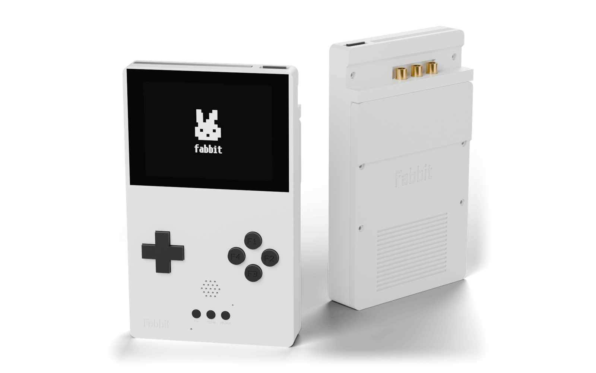
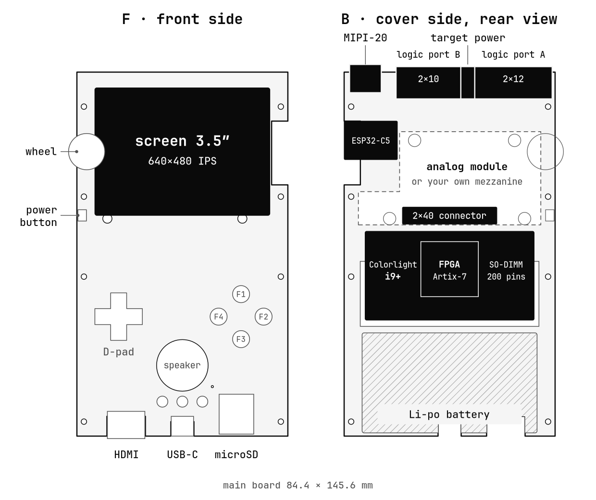
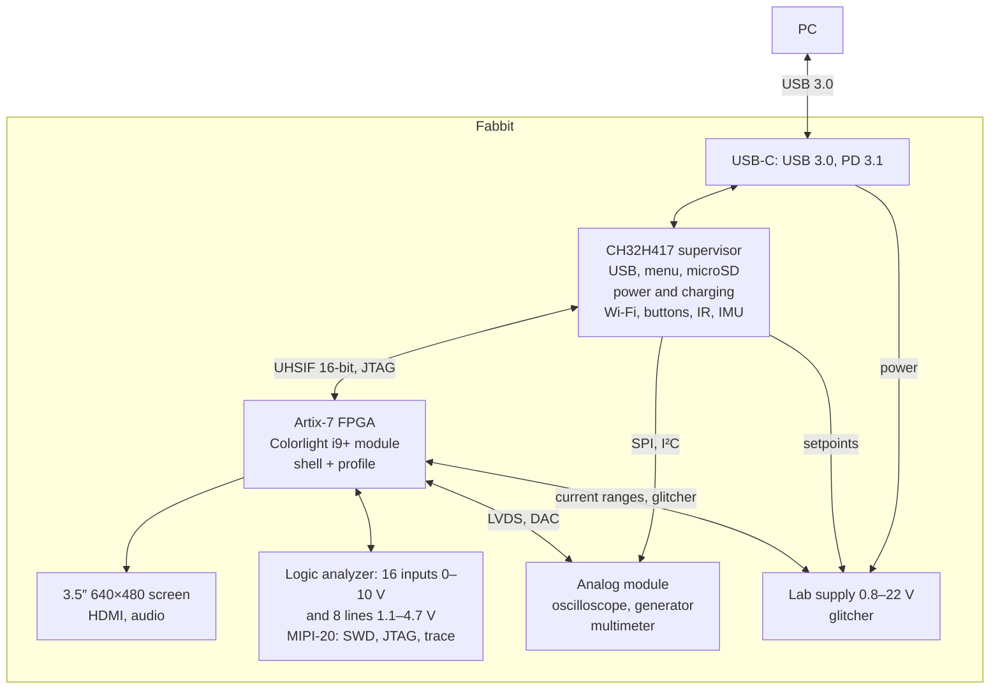
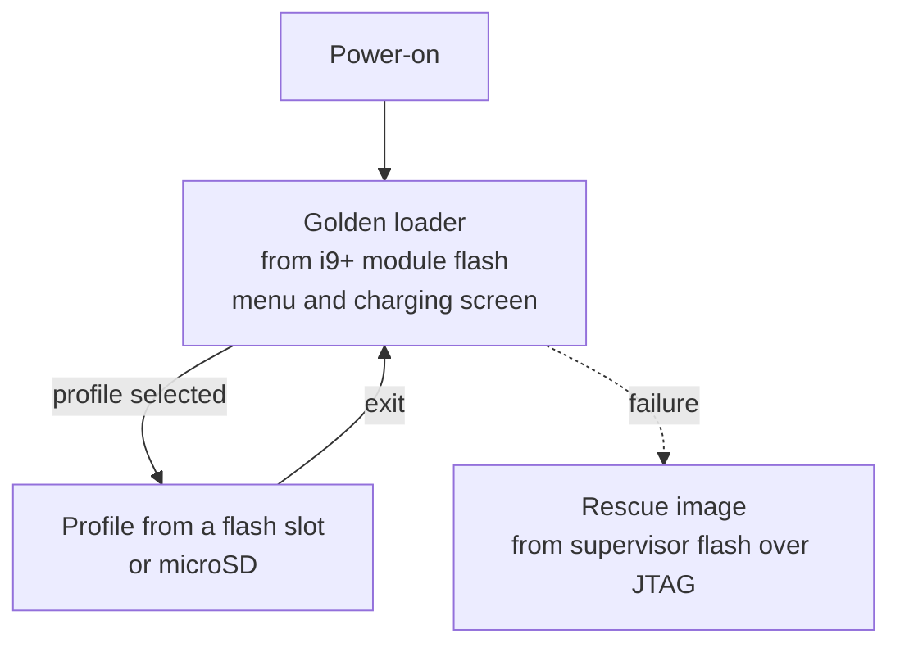
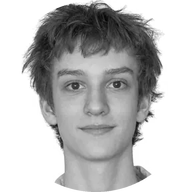

<h1 align="center">
  <picture>
    <source media="(prefers-color-scheme: dark)" srcset="docs/img/fabbit-logo-dark.png">
    
  </picture>
</h1>

<p align="center">
  An open-source pocket instrument for electronics engineers, built on an FPGA by two high school students.<br>
  A profile rewires the instrument.
</p>

<p align="center">
  <a href="README.md"></a>
  <a href="README.en.md"></a>
</p>

<p align="center">
  <a href="LICENSE"></a>
  <a href="hardware/LICENSE"></a>
  <a href="#hardware"></a>
</p>

<p align="center">
  
</p>

<p align="center">
  <sub>website <a href="https://fabbit.dev">fabbit.dev</a></sub>
</p>

## What it is

Fabbit puts a logic analyzer, a debugger, an oscilloscope, a signal generator, a multimeter
and a lab power supply in one case. Retro games run on the screen and over HDMI.

Inside is an Artix-7 FPGA module. A profile is an FPGA bitstream with the instrument logic;
you pick it from the menu.

Fabbit is for engineers and hardware hackers. The code, the boards and the case are open:
anyone can build their own profile or their own mezzanine board.

## Built-in profiles

| Profile | What it does |
|---|---|
| Logic analyzer | Port A: 16 inputs 0–10 V (survive ±30 V), threshold 0–6.8 V, CK and TRIG inputs. Port B: 8 bidirectional lines 1.1–4.7 V. Streaming to the PC: 50 MS/s on 16 channels or 100 MS/s on 8 |
| Debug & trace | CMSIS-DAP v2: SWD, JTAG, 4-bit trace, MIPI-20 connector |
| Oscilloscope | 2 channels, HMCAD1511 8-bit ADC, 2 × 312–375 MS/s, 2 × 400 MS/s after LVDS delay tuning, ×1/×10 probes |
| Signal generator | DAC904 14-bit DAC, 9.6 Vpp open circuit, 4.8 Vpp into 50 Ω. The output survives ±25 V |
| Multimeter | ADS1220 24-bit ADC: voltage, resistance |
| Lab power supply | 0.8–22 V with current limit: up to 20 W from a PD charger, up to 5 W from the battery. Measures voltage, current, power and energy. Up to 5.5 V output, current autoranges from 0.2 µA to 3 A |
| Glitcher | A switch shorts the target supply for a time set by the FPGA to inject voltage glitches |
| Retro console | Retro cores on the screen and HDMI, buttons, audio |

## Hardware

| Block | Specs |
|---|---|
| FPGA | Colorlight i9+ in a SO-DIMM socket: Artix-7 XC7A50T (32,600 LUT6, 2.7 Mbit BRAM, 120 DSP slices), 8 MB SDRAM, 16 MB flash |
| Supervisor | WCH CH32H417: menu, microSD, power and charging. 16-bit parallel UHSIF bus to the FPGA |
| Screen | 3.5″ IPS 640×480, HDMI mirrors the screen |
| Connectivity | USB 3.0, 5 Gbit/s. ESP32-C5: Wi-Fi 6 on 2.4 and 5 GHz, BLE 5, 802.15.4 |
| Power | USB-C PD 3.1: charging and 5 V output up to 1 A. 1S Li-po, 2800–3000 mAh, 3–9 h runtime ([estimate, in Russian](journal/2026-10-17.md)) |
| Input | 11 buttons, a clickable wheel, a power button |
| Peripherals | 1 W speaker, microphone, vibration motor, IR receiver and transmitter, IMU, RTC, microSD, Qwiic, status LED |
| Reference clock | 25 MHz TCXO, ±0.5 ppm: timebase and frequency counter |
| Case | 90 × 150 × 22.5 mm, 24 mm over the analog module, SLA print |

## How it works

<picture>
  <source media="(prefers-color-scheme: dark)" srcset="docs/img/fabbit-board-en-dark.png">
  
</picture>



The FPGA streams logic analyzer and trace data over the UHSIF bus into the supervisor's
USB 3.0 buffer, zero-copy.

| Layer | What it does |
|---|---|
| CH32H417 supervisor | Always on. Loads profiles into the FPGA, runs the lab supply and the multimeter |
| FPGA shell | The common part of every profile: supervisor bus, video to the screen and HDMI with a menu overlay, SDRAM, UART bridge to port B, safe pin states |
| Profile | The logic of one instrument on top of the shell |
| PC software | sigrok and PulseView, OpenOCD, pyOCD and probe-rs over CMSIS-DAP v2, orbuculum, SCPI, an MCP server for AI agents |

You pick a profile in the golden loader menu:



## Connectors

- **Top edge.** Port A 2×12 and port B 2×10 at 2.54 mm pitch, target power 2×2, MIPI-20.
- **Mezzanine connector.** BergStak 2×40, 0.8 mm pitch, 9 mm stack height. It carries 35 FPGA
  lines (20 of them in 10 LVDS pairs), supervisor SPI and I²C, power and the 25 MHz TCXO reference.

## Repository layout

```
gateware/            FPGA
├── common/          shell: bus, video, SDRAM
├── constraints/     pin assignments
├── profiles/        profile sources
├── sim/             simulation
└── tools/           build
firmware/            CH32H417 supervisor firmware
profiles/            microSD card contents
hardware/            boards and case
├── mainboard/       main board, KiCad 10
├── adc-mezzanine/   analog module
├── panel-adapter/   display adapter
├── case/            case, FreeCAD 1.1 and STL
└── docs/            bill of materials and datasheet checks
host/                PC software
├── sigrok/          libsigrok driver
└── tools/           utilities
docs/img/            README images
journal/             log: measurements and dead ends (in Russian)
```

## Team

&nbsp; **Roma Gorbachev**, lead engineer, programmer

&nbsp; **Yarik Pavlyuk**, case and 3D

## How to help

- Write your own profile, build your own mezzanine board, check schematics and boards against datasheets.
  Workflow (in Russian): [CONTRIBUTING.md](CONTRIBUTING.md).
- Questions and ideas: [Issues](https://github.com/fabbit-dev/fabbit/issues).
- Sponsor the project: [fabbit.dev/#support](https://fabbit.dev/#support).

Licenses: code MIT ([LICENSE](LICENSE)), hardware CERN-OHL-S-2.0 ([hardware/LICENSE](hardware/LICENSE)).
