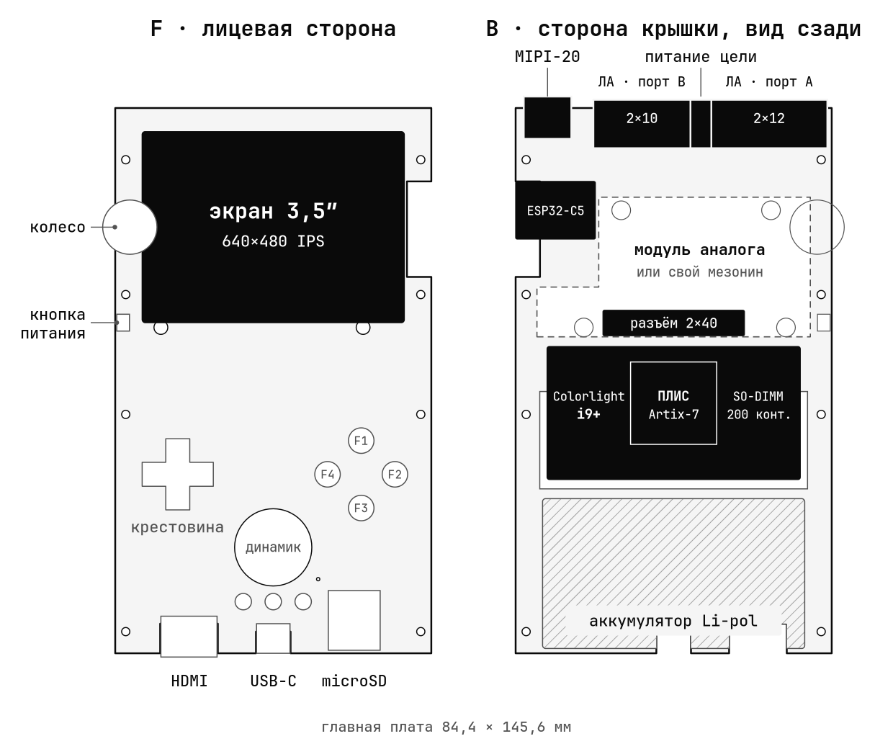
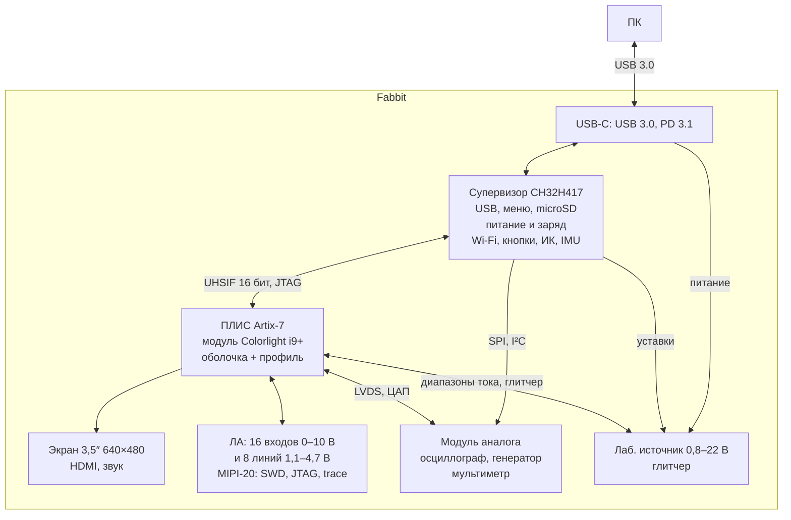
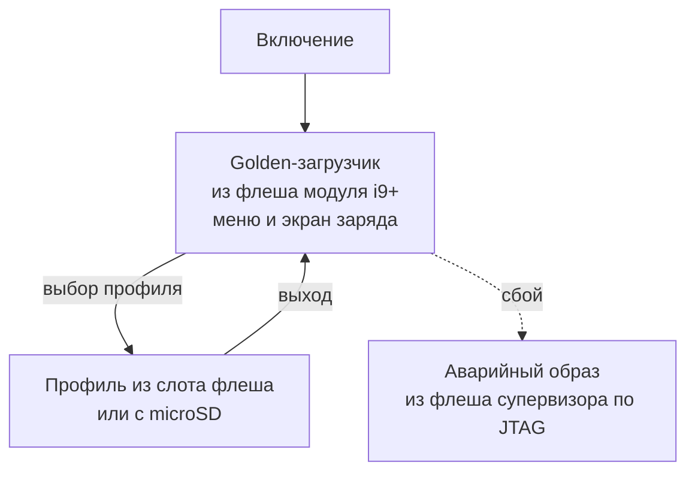

<h1 align="center">
  <picture>
    <source media="(prefers-color-scheme: dark)" srcset="docs/img/fabbit-logo-dark.png">
    
  </picture>
</h1>

<p align="center">
  Открытый карманный прибор электронщика на ПЛИС, сделанный двумя школьниками.<br>
  Профиль меняет схему прибора.
</p>

<p align="center">
  <a href="README.md"></a>
  <a href="README.en.md"></a>
</p>

<p align="center">
  <a href="LICENSE"></a>
  <a href="hardware/LICENSE"></a>
  <a href="#железо"></a>
</p>

<p align="center">
  
</p>

<p align="center">
  <sub>сайт <a href="https://fabbit.dev">fabbit.dev</a></sub>
</p>

## Что это

Fabbit собирает в одном корпусе логический анализатор (ЛА), отладчик, осциллограф,
генератор, мультиметр и лабораторный источник. На экране и по HDMI идут ретро-игры.

Внутри модуль ПЛИС Artix-7. Профиль — битстрим ПЛИС с логикой прибора, его выбирают в меню.

Fabbit для инженеров и исследователей железа. Код, платы и корпус открыты:
свой профиль или свою плату-мезонин может сделать любой.

## Профили из коробки

| Профиль | Что умеет |
|---|---|
| Логический анализатор | Порт A: 16 входов 0–10 В (выдерживают ±30 В), порог 0–6,8 В, входы CK и TRIG. Порт B: 8 двунаправленных линий 1,1–4,7 В. Поток в ПК: 50 MS/s на 16 каналах или 100 MS/s на 8 |
| Отладчик debug & trace | CMSIS-DAP v2: SWD, JTAG, trace 4 бит, разъём MIPI-20 |
| Осциллограф | 2 канала, АЦП HMCAD1511 8 бит, 2 × 312–375 MS/s, 2 × 400 MS/s после подстройки задержек LVDS, щупы ×1/×10 |
| Генератор | ЦАП DAC904 14 бит, 9,6 Впп без нагрузки, 4,8 Впп на 50 Ом. Выход выдерживает ±25 В |
| Мультиметр | АЦП ADS1220 24 бит: напряжение, сопротивление |
| Лабораторный источник | 0,8–22 В с ограничением тока: до 20 Вт от PD-зарядника, до 5 Вт от батареи. Измеряет напряжение, ток, мощность и энергию. При выходе до 5,5 В ток меряет с автодиапазоном 0,2 мкА…3 А |
| Глитчер | Ключ закорачивает питание цели на время, которое задаёт ПЛИС: атаки сбоем питания |
| Ретро-консоль | Ретро-ядра на экране и HDMI, кнопки, звук |

## Железо

| Узел | Параметры |
|---|---|
| ПЛИС | Colorlight i9+ в гнезде SO-DIMM: Artix-7 XC7A50T (32 600 LUT6, 2,7 Мбит BRAM, 120 DSP), SDRAM 8 МБ, флеш 16 МБ |
| Супервизор | WCH CH32H417: меню, microSD, питание и заряд. Параллельная шина UHSIF 16 бит к ПЛИС |
| Экран | IPS 3,5″ 640×480, HDMI с тем же кадром |
| Связь | USB 3.0, 5 Гбит/с. ESP32-C5: Wi-Fi 6 на 2,4 и 5 ГГц, BLE 5, 802.15.4 |
| Питание | USB-C PD 3.1: заряд и отдача 5 В до 1 А. Li-pol 1S, 2800 мА·ч, 3–9 ч работы ([расчёт](journal/2026-10-17.md)) |
| Ввод | 11 кнопок, колесо с нажатием, кнопка питания |
| Периферия | Динамик 1 Вт, микрофон, вибромотор, ИК приём и передача, IMU, RTC, microSD, Qwiic, светодиод состояния |
| Опорная частота | TCXO 25 МГц ±0,5 ppm: шкала времени и частотомер |
| Корпус | 90 × 150 × 22,5 мм, над модулем аналога 24 мм, SLA-печать |

## Как устроено

<picture>
  <source media="(prefers-color-scheme: dark)" srcset="docs/img/fabbit-board-dark.png">
  
</picture>



Поток ЛА и trace идёт из ПЛИС по шине UHSIF в буфер USB 3.0 супервизора без копирования.

| Слой | Что делает |
|---|---|
| Супервизор CH32H417 | Работает всегда. Грузит профили в ПЛИС, ведёт лабораторный источник и мультиметр |
| Оболочка ПЛИС | Общая часть каждого профиля: шина к супервизору, видео на экран и HDMI с меню поверх, SDRAM, UART-мост на порт B, безопасные состояния выводов |
| Профиль | Логика одного прибора поверх оболочки |
| ПО на ПК | sigrok и PulseView, OpenOCD, pyOCD и probe-rs по CMSIS-DAP v2, orbuculum, SCPI, MCP-сервер для ИИ-агентов |

Профиль выбирают в меню golden-загрузчика:



## Разъёмы

- **Верхний край.** Порт A 2×12 и порт B 2×10 с шагом 2,54 мм, питание цели 2×2, MIPI-20.
- **Разъём мезонина.** BergStak 2×40, шаг 0,8 мм, стек 9 мм. На разъёме 35 линий ПЛИС
  (20 из них в 10 парах LVDS), SPI и I²C супервизора, питание и опорные 25 МГц от TCXO.

## Структура репозитория

```
gateware/            ПЛИС
├── common/          оболочка: шина, видео, SDRAM
├── constraints/     назначение ножек
├── golden/          golden-загрузчик
├── diag/            проверки проводки
├── profiles/        исходники профилей
├── sim/             симуляция
└── tools/           сборка
firmware/            прошивка супервизора
└── ports/esp32s3/   стенд на ESP32-S3
profiles/            содержимое карты microSD
hardware/            платы и корпус
├── mainboard/       главная плата, KiCad 10
├── analog-module/   аналоговый модуль
├── panel-adapter/   переходник дисплея
├── case/            корпус, FreeCAD 1.1 и STL
└── docs/            компоненты (BOM) и проверка по даташитам
host/                ПО для ПК
├── sigrok/          драйвер libsigrok
└── tools/           утилиты
docs/                протокол шины, картинки README
journal/             дневник: замеры и тупики
```

## Команда

&nbsp; **Рома Горбачев**, главный инженер, программист

&nbsp; **Ярик Павлюк**, корпус и 3D

## Как помочь

- Написать свой профиль, сделать свою плату-мезонин, проверить схемы и платы по даташитам.
  Порядок работы: [CONTRIBUTING.md](CONTRIBUTING.md).
- Вопросы и идеи: [Issues](https://github.com/fabbit-dev/fabbit/issues).
- Поддержать проект деньгами: [fabbit.dev/#support](https://fabbit.dev/#support).

Лицензии: код MIT ([LICENSE](LICENSE)), железо CERN-OHL-S-2.0 ([hardware/LICENSE](hardware/LICENSE)).
